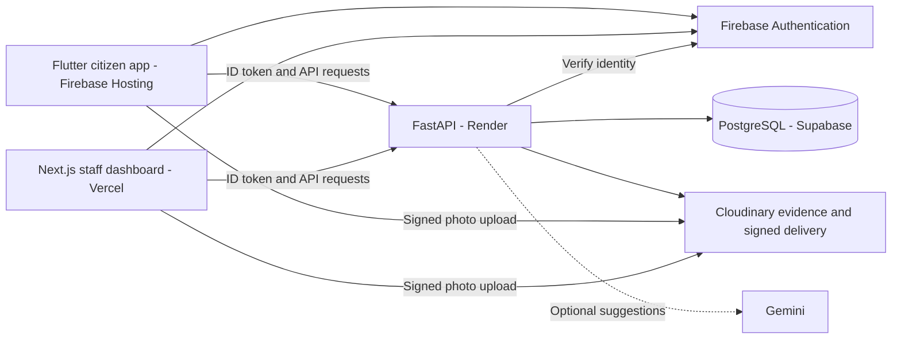

# Hacktober Hack Days

## Project Documentation Template


| Phase | Days | Focus |
|---|---|---|
| Ideate | Day 1 to 3 | Team formation, problem selection, research, scope and planning |
| Build | Day 4 to 10 | Core features, integrations and regular check-ins |
| Refine | Day 11 to 13 | Bug fixes, UI polish, testing and documentation |
| Deliver | Day 14 to 15 | Demo video, pitch and final submission |

## 1. Project Overview

| Field | Details |
|---|---|
| Project name | JanMaang |
| Team name | TragicBytes |
| Track / theme | Empowering Local Communities |
| One-line pitch | A civic demand-to-budget platform that turns local reports into transparent, community-verified projects. |
| Repository link | [HACKTOBER-by-SHEBUILDS](https://github.com/Arnav-Code-hub/HACKTOBER-by-SHEBUILDS) |
| Live citizen app | [Firebase Hosting](https://hacktober-by-she-builds.web.app) |
| Live staff dashboard | [Vercel](https://hacktober-by-shebuilds.vercel.app) |
| Backend health | [Render API health](https://hacktober-api.onrender.com/health) |
| Demo video link | [Video Demo](https://drive.google.com/file/d/1oX8UWCxqd1B8aBWgczOgVRHUPmciUrOa/view?usp=sharing) |


All three applications are deployed. The backend health check, dashboard page and
citizen app bundle responded successfully; the deployed citizen bundle uses the
hosted API. A complete report-to-verification journey on the hosted applications
and hosted acceptance checks for all ten accounts remain pending. Render's free
service can take time to wake after inactivity.

## 2. Team Members and Roles

| Name | Role | Responsibilities | Contact |
|---|---|---|---|
| Kanwaljeet Kaur | Team Lead | Planning and coordination | kanwal.kaur1310@gmail.com |
| Arnav Aggarwal | Developer | Frontend and backend | arnav.1251130495@vit.edu |
| Jagmeet Singh | Developer | UI / UX | jagmeetxsingh366@gmail.com |

## 3. Problem Statement

**The problem:** Local needs can be scattered across individual complaints, with
limited visibility into which demands receive priority, how funding is recorded,
who is responsible for execution, and whether the reported repair actually solves
the original citizen's problem.

**Who is affected:** Local communities, including rural communities, and the staff
and partner organizations responsible for responding to their needs.

**Why it matters:** Citizens need a visible way to raise problems and track the
response. Departments need a shared record connecting demand, prioritisation,
allocation, execution evidence and citizen feedback.

**Existing solutions and their gaps:** Complaint portals, messaging channels and
manual registers can capture issues, but the gap this prototype targets is a single
traceable workflow from collective demand through explainable prioritisation and
recorded funding to verification by the original reporter. This is the project's
problem hypothesis, not a claim that every existing platform lacks these features.

**Validation so far:** The team reports a five-person pilot; a formal pilot report
and measured outcomes are not documented here. A separate recorded acceptance run
verified fresh sign-ins and saved actions for all ten roles through local clients
using real Firebase, Supabase and Cloudinary. It does not establish public adoption
or independently measured community impact.

## 4. Proposed Solution

JanMaang collects local reports, groups related needs into shared demands, ranks
eligible demands on five published factors, records funding and work orders, and
closes a case only after the original reporter reviews the repair evidence and
confirms the fix. A rejected attempt returns to correction with its review history.

**Unique value:** One traceable path from an individual report to collective demand,
explainable ranking, funding, officer execution and citizen verification. Demo data
is identified as such; optional AI suggestions never decide status or funding.

**Implemented prototype features:**

- Citizen reporting with text, photos and location; voice input where supported by
  the client platform and its microphone permissions.
- Panchayat validation, location-based clustering, community support and five-factor
  prioritisation with visible ranking inputs.
- Recorded fund allocations, assigned work orders, progress and current-round
  completion photos.
- Original-reporter verification, correction rounds, audit entries, optimized
  Cloudinary images, before/after evidence and signed evidence cards.
- Public outcome statements, student teams, institute approval, submissions,
  faculty reviews and Industry/CSR pledges.
- District-scoped oversight and Super Admin role/organization management.
- Demonstration views for community information, rankings and ledger presentation;
  sample information must not be interpreted as measured public impact.
- Optional Gemini report suggestions with manual reporting available when AI is
  unavailable; real Gemini provider acceptance remains pending.

**Out of scope for this prototype:** Real government deployment or adoption,
real fund transfers or payments, production impact claims, and native Android/iOS
packaging and store distribution. Allocations and CSR pledges are records only.

## 5. Tech Stack and Architecture

| Layer | Technology | Why we chose it |
|---|---|---|
| Citizen frontend | Flutter / Dart, Riverpod, GoRouter | Shared app UI, state management and navigation; currently delivered as Flutter web. |
| Staff frontend | Next.js, React, TypeScript, shared workspace UI/tokens/contracts | Role-specific workspaces with shared styling and typed API integration. |
| Backend | Python, FastAPI, Pydantic, SQLAlchemy, asyncpg, Alembic | Typed request validation, transactional workflows and versioned database migrations. |
| Database | PostgreSQL hosted on Supabase | Relational integrity and transactions for reports, funding, review rounds and audit history. |
| Authentication | Firebase Authentication and Firebase Admin SDK | Email/password identity and server-side token verification; application roles and scopes remain in PostgreSQL. |
| Media | Cloudinary signed uploads and delivery transformations | Completion evidence, optimized images, before/after views and generated evidence cards. |
| Maps / optional AI | flutter_map with OpenStreetMap tiles; optional Gemini through google-genai | Manual map selection and optional report suggestions; AI is not required to complete reporting. |
| Hosting / deployment | Render Free, Vercel Hobby, Firebase Hosting Spark | Host the API, staff dashboard and citizen app respectively within a zero-rupee prototype target, subject to free-tier limits. |
| Tools | Git, GitHub Actions, pnpm, Flutter tooling, pytest, Ruff, mypy, import-linter, Vitest | Workspace builds, CI, static checks and automated verification. |

**Architecture overview:** Both clients sign in with Firebase and call the same
FastAPI service with Firebase ID tokens. The API validates identity, loads the
user's role and district/organization scope from PostgreSQL, and enforces workflow
permissions. Supabase hosts the database. Cloudinary stores evidence and serves
signed image transformations. Optional Gemini suggestions are requested through
the backend, keeping provider secrets out of the clients.



**Data flow:** Citizen report and evidence -> Panchayat validation and clustering ->
published ranking -> Department allocation and officer assignment -> Officer
completion evidence -> original citizen's verdict -> verified closure or another
correction round. Status changes and their audit entries are saved transactionally.

## 6. Feature Tracker

Feature owners below are technical ownership assignments from the supplied team
roles, not a claim of individual commit authorship.

| Feature | Owner | Priority | Status | Notes |
|---|---|---|---|---|
| Citizen reports, photos and map selection | Arnav Aggarwal | High | Implemented; local acceptance passed | Hosted report submission still needs acceptance. |
| Validation, clustering and prioritisation | Arnav Aggarwal | High | Implemented; local acceptance passed | Demo inputs and published factors remain visible. |
| Funding, work orders and officer evidence | Arnav Aggarwal | High | Implemented; local acceptance passed | Recorded allocations only; no money movement. |
| Citizen verification and evidence cards | Arnav Aggarwal | High | Implemented; real-provider local checks passed | Hosted report-to-verification journey pending. |
| Teams, submissions, approvals, reviews and CSR | Arnav Aggarwal | High | Implemented; local acceptance passed | Persisted actions checked after refresh. |
| Authentication and scoped administration | Arnav Aggarwal | High | Implemented; ten-role local acceptance passed | All ten hosted accounts still need acceptance. |
| Citizen and staff interface design | Jagmeet Singh | High | Implemented; refinement ongoing | Accessibility, responsive layout and presentation polish remain review items. |
| Three application deployments | Arnav Aggarwal | High | Deployed | Render API, Vercel staff dashboard and Firebase citizen web app; hosted integration acceptance pending. |
| Optional Gemini suggestions | Arnav Aggarwal | Low | Implemented; provider validation pending | Manual reporting works without AI credentials. |
| Demo video, slides and final submission | Kanwaljeet Kaur with the team | High | Pending | Links will be added when published. |

Acceptance details: [ten-account live acceptance](docs/development/ten-account-live-acceptance-2026-10-25.md)
and [local report-to-verification journey](docs/development/live-journey-2026-10-25.md).
Backend rules and phase scope: [implementation plan](docs/development/backend-plan.md).

---

# JanMaang

A civic demand-to-budget platform. A citizen reports a local need in their own
voice; AI structures it; identical reports are clustered so forty people asking
for the same handpump count as one demand with the weight of forty; the demand
is ranked against every other demand in the district on five published factors;
government funds down the ranked list; and the citizens who reported it decide
whether it was actually fixed.

**Speak → Analyze → Cluster → Prioritise → Fund → Execute → Citizen Verify**

## Status

A hackathon prototype. Everything below runs locally against demonstration
data; nothing claims real government adoption, payments or measured impact.

| Area | State |
|---|---|
| Citizen app (Flutter web) | Report with photos, track, verify a repair — wired to the live API contract; also runs in a labelled demo mode |
| Staff web app (Next.js) | Panchayat, Department, Officer, Student, Institute, Faculty, Industry/CSR and admin workspaces — wired to the live API contract |
| API — Phases 0–7 | Schema and migrations, seed data, Firebase verification, Cloudinary uploads, citizen reports, validation, clustering, ranking, funding, work orders, statements, citizen verdicts, signed evidence cards, partner teams/submissions/reviews, CSR pledges, scoped administration and optional Gemini report suggestions — implemented locally; real-provider checks pending |
| API — Phase 8 | Final hosted integration and demo readiness — **pending** |
| Hosting | Not deployed. Needs a Firebase project, Cloudinary, Supabase and Render (see the plan) |

The build order, rules and tests for each phase are in
[docs/development/backend-plan.md](docs/development/backend-plan.md); every
endpoint both clients call is specified in
[docs/api/day1-frontend-contract.md](docs/api/day1-frontend-contract.md).

## Run it locally

Prerequisites: Docker, Python with [uv](https://docs.astral.sh/uv/), Node 20+
with pnpm, and Flutter.

**1. Database** (PostgreSQL in Docker):

```bash
docker compose -f docker-compose.prototype.yml up -d postgres
```

**2. API** — <http://localhost:8000>, interactive docs at
<http://localhost:8000/docs>:

```bash
cd services/api
cp .env.example .env            # then set the required service credentials
uv sync --frozen --all-groups
uv run alembic upgrade head
uv run python -m app.seeds      # demonstration district, accounts and cases
uv run uvicorn app.main:app --reload
```

**3. Staff web app** — <http://localhost:3000>:

```bash
pnpm install --frozen-lockfile
cp apps/web/.env.example apps/web/.env.local   # Firebase web config + NEXT_PUBLIC_API_URL
pnpm --filter @janmaang/web dev
```

**4. Citizen app** — demo mode needs no accounts (labelled sample data, a
"DEMO MODE" banner, changes are temporary):

```bash
cd apps/mobile
flutter run -d chrome --dart-define=DEMO_SIGNED_IN=true
```

For the live app, copy `apps/mobile/config/live.example.json` to
`config/live.local.json`, fill in the public Firebase values and `API_BASE_URL`,
and run with `--dart-define-from-file=config/live.local.json`.

**Signing in needs Firebase.** Without a Firebase project the staff app shows
"Setup required" and the API refuses tokens. To enable it: create a project with
email/password sign-in, put its public web config in both clients, put the
service-account key in `services/api/.env` (`FIREBASE_CREDENTIALS_PATH`), create
the ten demo accounts and provision their UIDs with
`uv run python -m app.seeds --users-file seeds/demo/users.local.json`. Photo
uploads additionally need Cloudinary credentials and a signed upload preset.
Step-by-step notes:
[backend-phase1.md](docs/development/backend-phase1.md) (seeds and accounts),
[backend-phase2.md](docs/development/backend-phase2.md) (Firebase, Cloudinary,
deployment).

On a network that intercepts HTTPS, add `--system-certs` to `uv` commands.

## Checks

```bash
# API (from services/api) — tests use a real PostgreSQL container via Docker
uv run pytest
uv run ruff check . && uv run ruff format --check .
uv run mypy app && uv run lint-imports

# Web
pnpm --filter @janmaang/web typecheck
pnpm --filter @janmaang/web lint
pnpm --filter @janmaang/web test

# Citizen app (from apps/mobile)
flutter analyze && flutter test
```

After changing an API schema, regenerate the contracts and commit them with the
change: `scripts/gen-contracts.sh` (OpenAPI → `packages/contracts`).

## The repository

One repository, three ecosystems. Flutter uses pub, TypeScript uses pnpm
workspaces, Python uses uv. See
[ADR 0001](docs/architecture/decisions/0001-one-repository.md) for why.

```
apps/
  mobile/          Flutter — the citizen app
  web/             Next.js — the staff and partner workspaces in one application
services/
  api/             FastAPI modular monolith. Owns the schema.
  ai/              Internal AI service (not used by the prototype yet)
packages/
  contracts/       Generated API contract → TypeScript types
  tokens/          Design tokens → CSS variables + Dart constants
  ui/              React primitives (web only)
  config/          Shared lint/TS/Tailwind presets
infrastructure/    Docker, Terraform, Kubernetes, ops scripts
docs/              Architecture, ADRs, API contract, development plan and notes
scripts/           setup · doctor · contract generation
tests/e2e/         Cross-service journeys
```

## Stack

The prototype runs a deliberately small subset of the long-term architecture
(see [the plan](docs/development/backend-plan.md) for the reasoning).

| Layer | Prototype | Notes |
|---|---|---|
| Citizen app | Flutter web · Riverpod · go_router | Android/iOS packaging deferred |
| Staff web app | Next.js · TypeScript · React Query | One app, role-based workspaces |
| API | FastAPI · SQLAlchemy · Alembic | One service; owns the schema and every authorisation decision |
| Data | PostgreSQL 16 | Hosted target: Supabase. Distances computed in Python (no PostGIS needed yet) |
| Identity | Firebase Auth | Email/password; roles and scope come only from the database |
| Media | Cloudinary | Signed uploads, server-verified, signed delivery URLs |
| AI | Gemini (Phase 7) | Suggests category, severity and title; never decides status or funding |
| Background work | — | No Redis or worker in the prototype |

Design tokens are generated from one JSON source into both CSS variables and
Dart constants (`packages/tokens`), so the five-tier density palette cannot
drift between the map legend and the wordmark.

## Architecture decisions

| | Decision | Why |
|---|---|---|
| [0001](docs/architecture/decisions/0001-one-repository.md) | One repository, polyglot, no monorepo tool | A contract change is one PR, validated end-to-end |
| [0002](docs/architecture/decisions/0002-postgres-over-firestore.md) | Postgres primary; Firebase for identity | Dashboards and rankings are joins and aggregations |
| [0003](docs/architecture/decisions/0003-separate-ai-service.md) | One separate AI service, modular by capability | Long-term direction; the prototype calls Gemini from the API |
| [0004](docs/architecture/decisions/0004-single-web-app.md) | One web app with role-based routes | Nine apps would mean nine auth implementations |

## How the core rules are enforced

- **One source of truth for status.** Once reports are clustered, the
  cluster's status is the only copy; every change goes through one function
  that locks the record, checks the expected state, timestamps it and writes
  the audit entry in the same transaction.
- **Safe retries.** Writes carry an `Idempotency-Key`; a retry returns the
  original result, a reused key with different data is refused, and the
  database guarantees one allocation per cluster and one verdict per round.
- **Honest ranking.** Only open demand (`prioritised` clusters) is ranked, on
  five published factors. Community support counts unique citizens, not a
  population estimate; officer-set inputs that are still defaults are labelled.
- **Citizens close the loop.** Only the original reporter can verify a repair,
  against the specific round of evidence they reviewed.

## The map

Issues are plotted at their coordinates and **aggregated by location**: forty
citizens reporting the same handpump become one pin carrying the weight of
forty. Concentration is ranked across four tiers — green, amber, orange, red —
taken directly from the five colour bars under the logo wordmark, so the map
legend and the brand mark are the same palette.

Colour is never the only signal. Pin diameter (34 → 64px), ring weight and the
count badge all move with the tier, so the ranking survives greyscale and
colour-blindness. Only the critical tier pulses; animating every marker would
make the map unreadable.

## Data transparency

`docs/SOURCES.md` is the source of truth for provenance, and the app renders it
at `/method`: every dataset, its licence, what it feeds, what was rejected and
why.

Every seeded record is labelled as demonstration data, and the citizen app's
demo mode shows a permanent "DEMO MODE · Sample data" banner.

**No SLA or time-to-resolution metric appears anywhere.** The source grievance
data has no closure timestamp, so that number would have to be invented.
Supported metrics — reports by category, ward, quarter, status and volume — are
used instead.

## Design provenance

Every screen is built from the Stitch project *JanMaang Civic Intelligence
System* (`projects/5610348960166970948`). The colour roles, type scale, spacing,
radii and elevation recipe in `lib/core/theme/` are transcribed from that
design system rather than approximated — see
[docs/STITCH_INVENTORY.md](docs/STITCH_INVENTORY.md).

The staff web app adds a "bold accents" layer on the same tokens: condensed
display headings in [Anton](https://github.com/googlefonts/AntonFont) (SIL Open
Font License 1.1, bundled via `@fontsource/anton`), a charcoal sidebar, pill
controls and colour-block counters (`--jm-accent-*`). The accents are
decoration only; status, severity and density keep the five-tier palette.

## Security

No server-side credential ships in any client: Firebase service-account keys,
the Cloudinary secret and the Gemini key stay on the API. Authorisation is
enforced by the API on every request; client-side role checks only shape
navigation. Photos are uploaded with server-signed parameters, verified against
Cloudinary before use, and delivered through signed URLs. Secrets are scanned by
gitleaks in CI. See [SECURITY.md](SECURITY.md).

## Documentation

| | |
|---|---|
| [docs/development/backend-plan.md](docs/development/backend-plan.md) | Phase-by-phase backend plan, rules and tests |
| [docs/api/day1-frontend-contract.md](docs/api/day1-frontend-contract.md) | Every endpoint and response shape both clients use |
| [docs/development/backend-phase0.md](docs/development/backend-phase0.md) … [phase7](docs/development/backend-phase7.md) | What each built phase delivered, and how to run it |
| [apps/mobile](apps/mobile/README.md) | Citizen app — running it, demo mode, live configuration |
| [docs/product/roles.md](docs/product/roles.md) | The roles and the permission matrix |
| [docs/product/glossary.md](docs/product/glossary.md) | Demand vs Cluster vs Problem Statement vs Project |
| [docs/SOURCES.md](docs/SOURCES.md) | Data provenance — rendered by the app at `/method` |
| [CONTRIBUTING.md](CONTRIBUTING.md) | Branching and review rules |
